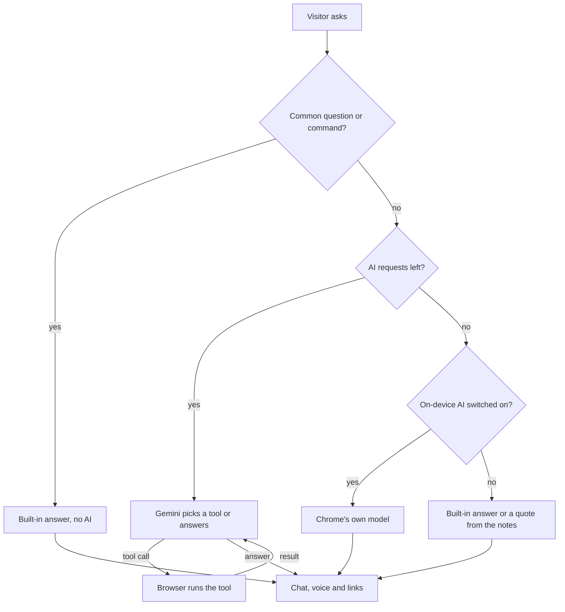

# AI features: what they are, how they work and why they are here

This portfolio has **66 AI options**. Visitors find them in the **AI** section of the site. They need no backend server, and they stay free while the Firebase project is on the Spark plan with no billing account.

- [The idea in one minute](#the-idea-in-one-minute)
- [How it works](#how-it-works)
- [Why it stays free](#why-it-stays-free)
- [Safety rules](#safety-rules)
- [Portfolio AI (18)](#portfolio-ai-18)
- [Developer AI Lab (19)](#developer-ai-lab-19)
- [Interactive (20)](#interactive-20)
- [Behind the scenes (9)](#behind-the-scenes-9)
- [Privacy: what goes where](#privacy-what-goes-where)
- [What was checked](#what-was-checked)
- [Settings and upkeep](#settings-and-upkeep)
- [Where the code is](#where-the-code-is)

---

## The idea in one minute

A normal chatbot only talks. **ALPHA is an agent**: Gemini chooses a tool, the browser runs it, the result goes back to Gemini, and it repeats until there is an answer.

Three decisions shape everything:

1. **The site decides facts, the AI decides words.** Whether Kishore has used Docker is looked up in the site's own data. The AI is not asked to remember it.
2. **Every AI tool has a no-AI version.** When the free quota is gone, visitors still get something useful, and it is labelled as made without AI.
3. **The visitor is in charge.** ALPHA can draft an email or propose a meeting, but only the visitor can send or save it.

## How it works

**The agent loop** (`agent.service.ts`) uses at most 3 Gemini requests for one question, and the last must be an answer in words. The same tool call is never run twice, and at most 4 tools run in one turn.

**ALPHA's 14 tools** (`agent.tools.ts`):

| Tool | What it does |
|---|---|
| `goToSection` | Scrolls to a section |
| `showProject` | Brings a project to the front |
| `findEvidence` | Looks up where a skill was really used |
| `searchStudyNotes` | Finds passages in the study notes |
| `githubActivity` | Reads public GitHub repositories |
| `draftMessage` | Fills in the contact form, never sends |
| `planMeeting` | Opens a meeting card, books nothing |
| `startInterview` | Opens the mock interview |
| `openJobMatcher` | Opens the job matcher |
| `openAiTool` | Opens any AI Lab tool |
| `copyContact` | Copies the email or phone number |
| `offerResume` | Shows a resume button |
| `setTheme` | Switches light or dark |
| `planTour` | Builds a spoken tour for the time available |

Some tools know the whole answer themselves ("I've opened the job matcher"). They end the loop after 1 request instead of 2.

**AI Lab tools** (`src/app/lab/`) are simpler: one form, one prompt, one request. Each has its own address, such as `/lab/compare`, and the Back button closes it.

**The conversation engine** (`dialogue.ts`) keeps the thread without AI. It remembers the topic, so "tell me more", "which technology?" or "show it" make sense. It asks a question back, understands "yes" and "no", and offers reply buttons. It can also remember a name until the page closes. When Gemini is available, Gemini handles open follow-ups. **Small talk** (`small-talk.ts`), such as "are you there", is answered at once and is never sent to Gemini in English.

## Why it stays free

| Service | Used for | Cost control |
|---|---|---|
| Gemini through Firebase AI Logic | All cloud AI | Spark plan with no billing: past the quota, requests fail instead of charging |
| Firebase App Check | Blocks use from other sites and bots | Free tier |
| Firestore | Guestbook | Free tier |
| GitHub API | Public repositories | No key, 60 requests an hour per visitor |
| EmailJS | Contact form | Existing free account |
| Chrome built-in AI, speech, IndexedDB | On-device features | Built into the browser |
| Mermaid, pdf.js, axe-core, SQLite, search model | Diagrams, PDFs, audits, SQL, search | Open source, loaded only when used |

**The free Gemini quota is shared by all visitors**, so `ai-budget.ts` protects it:

- 15 requests per browser per day, shared across tabs, resetting at midnight Pacific time.
- When the daily quota is gone, that browser stops until the next day.
- When Gemini says "too many requests", it waits 1 minute, then 5, then 25, up to an hour.
- When App Check, the key or the model is refused, it waits 10 minutes instead of wasting requests.
- The AI Lab leaves 2 requests for the chat, and the interview leaves 3.

This protects against normal use, not abuse: a visitor can clear their storage.

## Safety rules

| Risk | What prevents it |
|---|---|
| AI invents a skill | Skills are checked with `evidence.ts`; matches are decided by site data |
| AI invents a requirement | Requirements the job text never mentions are dropped |
| AI calls a tool with bad values | Every value is checked; unknown projects, sections and tools are refused |
| Instructions hidden in pasted text | Pasted text is treated as data, and it can't change a match result |
| Dangerous links or HTML | Links come only from site data; AI text is never shown as HTML |
| Dangerous diagrams | Drawn as an image, so nothing inside can run |
| Visitor code attacking the page | It runs in a sealed frame with no network, stopped after 4 seconds |
| Sending without consent | Only the visitor's click sends a message |
| Runaway use | Request limits, timeouts and a Stop button |

---

In the tables below, **AI** is the number of Gemini requests for one use.

## Portfolio AI (18)

| Option | What it does and why | How it works | AI | Without AI |
|---|---|---|---|---|
| **Personal AI twin** | Answers as "I". Visitors get to know Kishore in a natural way | The site's facts plus a rule to say it is an AI and make no promises | 1 | ALPHA's built-in answer |
| **Portfolio chatbot** | ALPHA answers and acts on the page, so visitors don't have to hunt for things | The agent loop above | 1–3 | Built-in answers and note quotes |
| **Project exploration agent** | Any question about one project | The project's facts in the prompt | 1 | Features, technology and related projects |
| **Skills analysis** | Shows which skills are backed by real work. Honest proof beats a list | Counts projects and jobs per skill | 0 | Same |
| **Recruiter assistant** | A one-page brief with gaps and questions. Saves a recruiter time | Facts plus a fixed structure | 1 | A brief from site data |
| **Job description matcher** | Requirement-by-requirement match. The most useful tool for recruiters | Gemini only lists the requirements; site data decides Proven, Listed, Partial, Gap or Ask | 1 | Keyword reader |
| **Hiring panel** | Recruiter, tech lead and critic discuss a match. Shows several views, including the critical one | Three roles in one request; every point must cite a match row | 1 | Rule-based panel |
| **Resume analyzer** | Reviews the visitor's own resume | Ten automatic checks, then AI advice | 1 | The ten checks |
| **Cover letter generator** | A draft letter from Kishore for a job | Links requirements to real projects | 1 | Template built from the match |
| **Email generator** | Writes an email to Kishore | Uses only what the visitor typed | 1 | Template |
| **Contact agent** | Drafts inside the contact form. Removes the "what do I write" problem | Fills in the form, with Undo | 1 | Template |
| **Career recommendation** | Suggests roles for the visitor's skills | AI advice with chapters to study | 1 | Compares skills with nine roles |
| **Guided tour** | ALPHA walks and talks through the page | Scroll plus speech; tailored tours come from `planTour` | 0, or 1 tailored | Standard tour |
| **Project comparison** | Two projects side by side | Table from site data | 0 | Same |
| **GitHub explorer** | Shows public repositories, live | GitHub's public API | 0 | Same |
| **Project documentation** | A README for a project | Facts only; no invented commands | 1 | README from site data |
| **Architecture explainer** | How a project probably fits together | Inferred from the technology list, and says so | 1 | Rule-made diagram |
| **Meeting agent** | Turns "Tuesday 4 pm" into a calendar file and a draft message | A time parser; shows both time zones; books nothing | 0 from the form; 1 if asked in chat | Same |

## Developer AI Lab (19)

| Option | What it does and why | How it works | AI | Without AI |
|---|---|---|---|---|
| **Agent test suite** | Proves the agent follows its rules. Rare in a portfolio | 29 scripted tests with written replies in place of Gemini, plus a live mode | 0, or up to 15 live | Scripted tests |
| **Agent trace viewer** | Shows each step, tool, time and token count. Makes the agent understandable | Every request and tool is recorded in memory | 0 | Same |
| **Search by meaning** | Finds notes without the exact words | A 2 MB word-vector model in the browser | 0 | Same |
| **SQL playground** | Runs SQL on sample tables. Lets visitors try a query | SQLite in a worker, fresh every run | 0 | Same |
| **JavaScript runner** | Runs code safely | A sealed frame and a worker | 0 | Same |
| **Java coding assistant** | Java help | A Java 21 prompt | 1 | Closest study notes |
| **Spring Boot generator** | A CRUD API from an entity | A Spring Boot 3 prompt | 1 | Code generator for entity, repository and controller |
| **SQL query assistant** | Queries for four databases | A prompt with the visitor's tables; "Run it" opens the playground | 1 | Closest study notes |
| **Angular assistant** | Modern Angular help | A signals and standalone prompt | 1 | Closest study notes |
| **Microservices designer** | Services, data and a diagram | An architect prompt with Mermaid | 1 | Outline from the listed services |
| **Mermaid diagram generator** | Draws a described flow | AI writes Mermaid, the browser draws it | 1 | Draws "A -> B -> C" |
| **Code review** | Finds problems, worst first | Pattern checks plus AI | 1 | Sixteen pattern checks |
| **Java interview agent** | A Core Java interview | Mock interview set to Core Java | 1 per answer | Keyword score |
| **Mock interview** | Five scored questions that adapt | Questions come from the notes; a low score brings another from that chapter | 1 per answer | Keyword score |
| **Technical quiz** | Multiple choice from the notes | Wrong options are answers to other questions | 0, or 1 AI-written | Notes quiz |
| **Debugging assistant** | Likely causes of an error | AI, or a list of known errors | 1 | 19 known errors, then notes |
| **Learning roadmap** | A weekly study plan | Splits chapters by week; AI adjusts it | 1 | Plan from the chapters |
| **Concept explainer** | Explains a topic at three levels | Study notes are given to the AI first | 1 | Closest notes |
| **Answers from notes** | ALPHA answers interview questions and names the chapter | Finds passages, then answers only from them | Usually 2 | A quote from the notes |

## Interactive (20)

| Option | What it does and why | How it works | AI |
|---|---|---|---|
| **Live talk** | A hands-free conversation: you speak, ALPHA answers, then listens again. Say "stop" to end | Browser speech, plus Gemini when it is available and the conversation engine when it isn't | Same as chat |
| **Page remote control** | "Scroll down", "next project", "dark mode". Useful for hands-free browsing | Fixed commands, matched exactly | 0 |
| **Skill detective** | Guess the skill ALPHA is thinking of. A playful way to see the real skills | Clues come from site data | 0 |
| **Rock, paper, scissors** | Play a robot that adapts | Counts what you usually play after each move; it decides before seeing yours | 0 |
| **Code typing race** | Type a line of code faster than ALPHA | Timed in the browser; pasting is blocked | 0 |
| **Robot studio** | Direct a show from ALPHA's moves | Plays poses in order, also on the page | 0 |
| **Daily challenge** | One interview question a day, with a streak | Same question for everyone, chosen from the date | 0 |
| **Voice assistant** | Say "Alpha" and ask out loud. Hands-free and memorable | Browser speech recognition | Same as chat |
| **Text to speech** | Reads sections and results aloud | Browser speech synthesis | 0 |
| **Skill graph** | Links skills to projects visually | TypeScript and SVG | 0 |
| **Project timeline** | Education, jobs and projects in order | Angular component | 0 |
| **AI-generated diagrams** | Diagrams that can be saved as SVG | Mermaid | 1 |
| **Navigation agent** | "Show the EMR project, then contact" | Reads the steps, then scrolls | 0 |
| **Resume PDF analysis** | Checks a PDF without uploading the file | pdf.js reads it in the browser | 1 |
| **AI answer checker** | Scores an AI answer and flags claims. Teaches healthy doubt | Automatic checks plus AI | 1 |
| **Agent team** | Planner, researcher, writer, critic and editor. Shows how agents work together | The researcher is plain code; the others take turns | 3–4 |
| **Accessibility audit** | Checks this page | axe-core on the live page | 0 |
| **Offline app** | Installs the site and works without internet | Angular service worker | 0 |
| **Guestbook** | Public notes, shared with Kishore.OS | Firestore | 0 |
| **Saved results** | Keeps results on the device | IndexedDB | 0 |

## Behind the scenes (9)

| Option | What it does and why | How it works |
|---|---|---|
| **Session memory** | The chat survives a reload | `sessionStorage`, gone when the tab closes |
| **Visitor memory** | Remembers role and interests, so help is relevant | `localStorage`; only a role and names from this site, never free text. "Forget me" clears it |
| **Proactive guide** | Offers help after 18 seconds on a section | At most 3 offers; stops after 2 dismissals |
| **On-device AI** | A fallback when Gemini is resting | Chrome's built-in model, only if the visitor switches it on |
| **Select and ask** | Ask about any text on the page | A button appears on selection |
| **Tamil and Hindi** | Replies in the visitor's language | An instruction to Gemini; short ready-made texts without it |
| **Feedback buttons** | Shows which answers help | Saved on the device, or in Firestore if switched on |
| **AI-friendly site** | Helps search engines and AI tools read the profile | `llms.txt` and structured data, without phone or email |
| **WebMCP tools** | Lets a visitor's own AI agent use 7 of these tools | A Chrome origin trial; needs a token |

A **shared answer cache** (answers Kishore approved, served without AI) is also built, but it is switched off.

## Privacy: what goes where

| Data | Where it goes |
|---|---|
| Questions and pasted text | Google Gemini, when AI is used |
| Remembered role and interests | This browser; a short note is added to Gemini questions |
| Resume PDF file | Stays in the browser; only its text goes to Gemini |
| Voice | The browser's own speech service |
| Contact form | EmailJS, only after Send |
| Guestbook notes | Firestore, public |
| Ratings | This device, unless shared feedback is switched on |
| Traces | Memory only |
| Saved results | IndexedDB on this device |

"Forget me" clears the memory, chat context, ratings, traces and saved results.

## What was checked

Checked on 26 November 2026, on the production build.

| Check | Result |
|---|---|
| Type check and production build | Pass |
| Scripted agent tests | 29 of 29 pass |
| All 38 AI Lab tools × 4 conditions (AI working, quota gone, garbage replies, server errors) | All finish with a result or a clear message. After the last fixes, the affected tools were run again |
| Phone width (390 px) in three of those conditions | No overflow |
| All 14 ALPHA tools through the chat | 13 pass; `copyContact` correctly reported that the test frame blocks the clipboard |
| Job matcher, panel, interview, quiz, contact draft, memory, WebMCP | Pass |
| Guestbook reading | Pass on the real database; posting was not tested |
| Offline with the server stopped | Pass: SQL playground, interview and AI list |

**Simulated:** Gemini, GitHub, EmailJS, Chrome's on-device model and WebMCP.

**Found and fixed during this check:**

1. The accessibility audit could close itself on a slow browser.
2. The diagram tool showed plain text when the AI returned no diagram. It now draws the simple one.
3. Refused requests (App Check, key or model) used up a visitor's daily limit. They now cause a 10-minute rest.

**Not proven yet:**

- **Real Gemini replies.** The live site was asked one question from an automated browser. App Check answered "App attestation failed" and Gemini returned 401. That is expected for a browser that looks like a bot, but it has to be confirmed in a normal one (below). The model name is therefore unconfirmed too.
- Hindi and Tamil wording and voices, the on-device model, WebMCP, and Firestore extras.
- The build on Node 22, which the deploy uses (Node 26 was used here).

**How to confirm Gemini in 30 seconds**

1. Open <https://kishore-new.web.app> in your normal Chrome, with no automation.
2. Ask ALPHA: "How does Kishore approach healthcare software?"
3. Open DevTools → Network and filter by `generateContent`.

| You see | It means |
|---|---|
| 200 | Gemini works |
| 401 | App Check is refusing visitors. Check the reCAPTCHA key and allowed domains in Firebase → App Check |
| 404 | The model name is wrong. Change `GEMINI_MODEL` in `firebase.config.ts` |
| 429 | The free quota is used up |

## Settings and upkeep

| Task | Where |
|---|---|
| Daily limit per browser | `DAILY_REQUESTS` in `ai-budget.ts` |
| Gemini model | `GEMINI_MODEL` in `firebase.config.ts` |
| Turn on WebMCP | `WEBMCP_ORIGIN_TRIAL_TOKEN` in `site.config.ts` |
| Turn on shared answers and feedback | `FIRESTORE_EXTRAS` in `site.config.ts`, after the steps in `firestore/README.md` |
| Add or remove an option in the AI section | `ai-features.data.ts` |
| Run the agent tests | `npm run evals` (a failing test also stops the deploy) |
| After editing the study guides | `npm run notes` |
| After editing the portfolio data | `npm run ai-files` |

## Where the code is

| Folder or file | What is in it |
|---|---|
| `src/app/core/agent.service.ts`, `agent.tools.ts` | The agent loop and ALPHA's tools |
| `src/app/core/cloud.service.ts`, `structured-ai.service.ts`, `device-ai.service.ts` | Gemini, the fallback order, on-device AI |
| `src/app/core/ai-budget.ts` | Free-quota protection |
| `src/app/core/evidence.ts`, `job-match.ts`, `hiring-panel.ts` | Evidence, matching and the panel |
| `src/app/core/notes.service.ts`, `semantic.ts` | Study notes and search by meaning |
| `src/app/core/interview.ts`, `interview.service.ts` | Mock interview |
| `src/app/core/visitor-memory.service.ts`, `guide.service.ts`, `language.service.ts` | Memory, proactive guide, languages |
| `src/app/lab/` | The AI Lab: tools, no-AI rules, agent team, tests, sandboxes |
| `src/app/sections/ai.ts`, `ai-catalog.ts`, `ai-orbit.ts`, `ai-list.ts` | The AI section: orbit view and list view |
| `src/app/sections/ai-launcher.service.ts` | Opening options, suggested paths, ring colours and intent search |
| `scripts/` | Notes, search model, tests and AI-friendly files |
