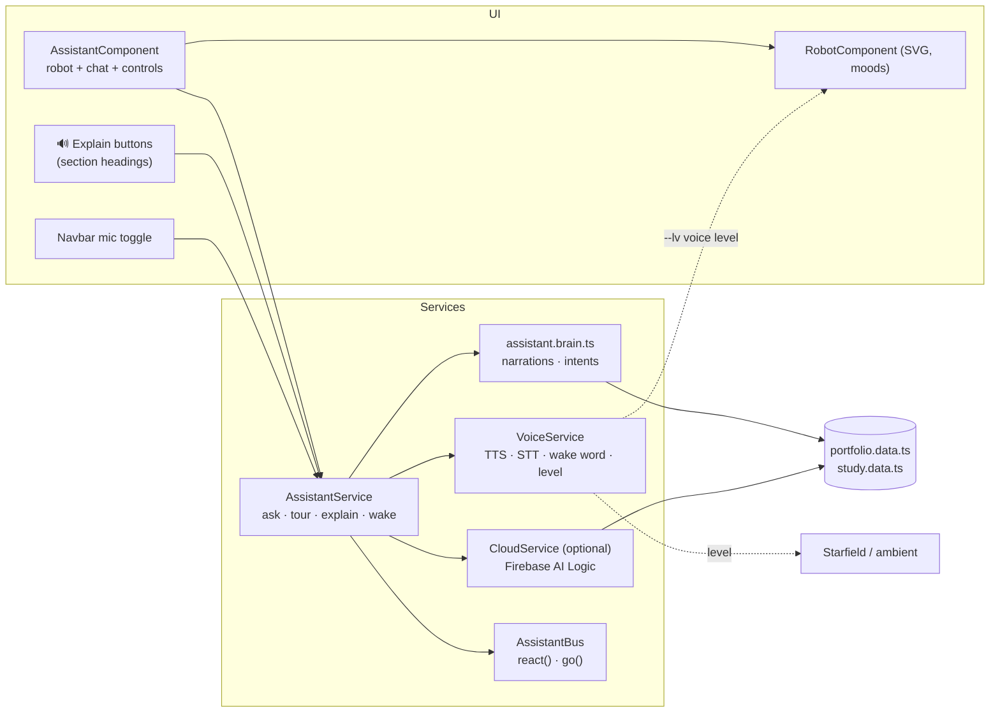
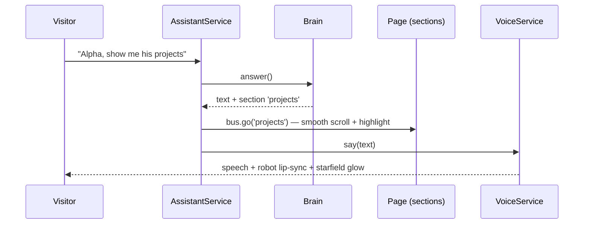

# R&D — Adding a Chatbot + Speaking Bot to the 3D Portfolio

> How to bring **ALPHA** (the talking robot assistant from [Kishore.OS](https://github.com/Kishore1199/kishore-os)) into this 3D scrolling portfolio.
> Status: **design & implementation plan** — reuses proven code from Kishore.OS, adapted to a single-page scroll layout.

---

## 1. Goal

Add an assistant that visitors can **talk to and hear back from**:

| Capability | What the visitor experiences |
|---|---|
| Chat | Floating robot → chat panel; ask "What are his skills?", get an answer |
| Speaking | Answers are **read aloud**; the robot's mouth moves with the voice |
| Voice input | Tap 🎤 and ask out loud (Chrome / Edge / Safari) |
| Wake word | Optional: say **"Alpha, …"** hands-free |
| Guided tour | Robot scrolls the page section by section and narrates each one |
| Explain buttons | 🔊 on each section heading reads that section |
| Real AI (optional) | Gemini via Firebase AI Logic, with an offline fallback |
| Personality | 18 moods: talking, listening, sleepy, giggle when poked, party on copy… |

**Constraints:** keep 60 fps scrolling and the 3D hero/starfield smooth, no backend required, no secret keys in the browser, works offline.

---

## 2. What changes vs. Kishore.OS

Kishore.OS is a desktop with **windows**; this project is a **scrolling page of sections**. The assistant stays the same; only the "navigation" layer changes.

| Kishore.OS concept | 3D portfolio equivalent |
|---|---|
| `AppId` (`about`, `projects`, …) | Section id: `home`, `about`, `skills`, `projects`, `experience`, `education`, `prep`, `contact` |
| `os.open('projects')` | `nav.go('projects')` → smooth-scroll + highlight pulse |
| Window "Explain" button | 🔊 button in each section heading |
| Tour opens each app | Tour **scrolls** to each section, waits, narrates |
| Aurora wallpaper reacts to voice | **Starfield / ambient glow** reacts to voice level |
| `OsService.react()` emote channel | New tiny `AssistantBus` service (same API) |
| Dock / menu bar mic button | Navbar mic button |

---

## 3. Architecture



---

## 4. File plan

| New file | Source in Kishore.OS | Change needed |
|---|---|---|
| `core/voice.service.ts` | `core/voice.service.ts` | **Copy as-is** (TTS, STT, wake word, level envelope) |
| `core/assistant.brain.ts` | `core/kai.brain.ts` | Replace `AppId` with `SectionId`; rewrite narrations for sections |
| `core/assistant.service.ts` | `core/kai.service.ts` | Replace `os.open()` with `bus.go()`; tour scrolls instead of opening windows |
| `core/assistant.bus.ts` | parts of `core/os.service.ts` | Only `react()`, `go()`, `notify()`, `copy()` |
| `core/cloud.service.ts` *(optional)* | `core/cloud.service.ts` | Copy; drop guestbook methods if not needed |
| `core/firebase.config.ts` *(optional)* | same | Same project `kishore-os`; add this site's domain to the reCAPTCHA key |
| `layout/robot.ts` | `shell/robot.ts` | **Copy as-is** (SVG robot, 18 moods, touch zones) |
| `layout/assistant.ts` | `shell/kai.ts` | Remove `OsService`; position above the footer; keep drag, reactions, chat |
| `core/section-explain.ts` | — (new) | Small `<app-explain section="skills" />` button component |

Wire-up in `app.ts`: add `<app-assistant />` after `<app-footer />`.

---

## 5. Step-by-step implementation

### Step 1 — Voice engine (copy)
Copy `voice.service.ts` unchanged. It already provides:
- `say(text)` → speaks with the best English voice, word-boundary captions, **`level` signal (0…1)** for lip-sync, timed fallback for voices without boundary events, Chrome 15-s keep-alive.
- `listen()` → one spoken question (en-IN, interim results).
- `enableWake(cb)` / `holdWake()` → continuous "Alpha…" wake word that pauses while speaking.

> Browser rule: speech can only start **after a user gesture**. The first `say()` must come from a click (chat button, "Hear the tour", or an Explain button).

### Step 2 — Navigation bus
```ts
// core/assistant.bus.ts
export type SectionId = 'home' | 'about' | 'skills' | 'projects' | 'experience' | 'education' | 'prep' | 'contact';

@Injectable({ providedIn: 'root' })
export class AssistantBus {
  readonly emote = signal<{ mood: string; ms: number; n: number } | null>(null);
  readonly focus = signal<SectionId | null>(null);       // section being narrated (for a highlight ring)
  private n = 0;

  react(mood: string, ms = 1800) { this.emote.set({ mood, ms, n: ++this.n }); }

  /** Scroll to a section and pulse it. Resolves when the scroll has (roughly) finished. */
  go(id: SectionId): Promise<void> {
    const el = document.getElementById(id);
    if (!el) return Promise.resolve();
    this.focus.set(id);
    el.scrollIntoView({ behavior: matchMedia('(prefers-reduced-motion: reduce)').matches ? 'auto' : 'smooth', block: 'start' });
    return new Promise(r => setTimeout(r, 700));
  }
}
```
Add a highlight style in `styles.scss`:
```scss
section.assistant-focus { outline: 2px solid color-mix(in srgb, var(--accent) 60%, transparent); outline-offset: -8px; border-radius: 28px; transition: outline-color .4s; }
```
(an effect toggles the class on `bus.focus()`).

### Step 3 — Brain (data-driven narration + intents)
Port `kai.brain.ts` with section ids. Every sentence is generated from `portfolio.data.ts`, so it never drifts from the site:
```ts
export const NARRATION: Record<SectionId, string> = {
  home: `Hi, I'm Alpha, I'm here to assist you. This is ${PROFILE.name}, a ${PROFILE.role} from Chennai…`,
  skills: `Kishore's toolbox has ${SKILLS.length} technologies in ${SKILL_CATEGORIES.length} groups…`,
  // about, projects, experience, education, prep, contact …
};
export const TOUR: { section: SectionId; text: string }[] = [ { section: 'home', text: NARRATION.home }, /* … */ ];
export function answer(q: string): Reply { /* same ordered intent rules; `open` → `section` */ }
```
Keep the lessons learned:
- Match the **full project title first**, then keywords — check **"EMR" before "EHR"** (both start with "75Health").
- Navigation intents ("show projects") run **instantly**, even when the AI path is enabled.

### Step 4 — Assistant service
```ts
async ask(q: string) {
  this.msgs.update(m => [...m, { from: 'me', text: q }]);
  const r = answer(q);                       // offline brain
  if (r.section) this.bus.go(r.section);     // instant action
  let reply = r.text;
  if (this.cloud.enabled) {                  // optional Gemini
    this.thinking.set(true);
    reply = (await this.cloud.ask(q)) ?? reply;   // null on error/timeout → keep offline text
    this.thinking.set(false);
  }
  this.msgs.update(m => [...m, { from: 'bot', text: reply }]);
  await this.voice.say(reply);
}

async tour(from = 0) {
  const run = ++this.tourRun;
  for (let i = from; i < TOUR.length; i++) {
    if (run !== this.tourRun) return;        // stopped / skipped
    this.step.set(i);
    await this.bus.go(TOUR[i].section);      // scroll first…
    await this.voice.say(TOUR[i].text);      // …then narrate
  }
  this.step.set(-1);
  this.bus.react('wow', 2200);
}
```
Wake word: same as Kishore.OS — an effect holds the recognizer while `speaking || listening || thinking || touring`.

### Step 5 — Robot + chat UI (copy & trim)
- `robot.ts`: copy unchanged — pure SVG, moods via `@switch`, colour via `--mood`, mouth via `--lv`.
- `assistant.ts` (from `shell/kai.ts`): keep chat panel, mic button, wake toggle, tour controls, drag-anywhere, touch reactions, eye tracking, sleep/yawn timers; replace `OsService` with `AssistantBus`.
- Place it `position: fixed` bottom-right **above the footer**, `z-index` below the resume modal.
- On phones: smaller scale, chat panel full-width.

### Step 6 — Explain buttons per section
```ts
@Component({ selector: 'app-explain', template: `<button class="explain" (click)="speak()" [attr.aria-label]="'Explain ' + section()">🔊 Explain</button>` })
export class Explain { section = input.required<SectionId>(); private a = inject(AssistantService);
  speak() { this.a.explain(this.section()); } }
```
Drop `<app-explain section="skills" />` next to each section title (`about.ts`, `skills.ts`, …).

### Step 7 — Make the 3D scene react (optional polish)
- **Starfield:** read `voice.level()` in its existing frame loop and raise opacity/glow while ALPHA speaks (the starfield already has a "scrolling" glow class — reuse it).
- **Hero three.js:** scale the emissive intensity of the core by `1 + level * 0.6` → the planet "pulses" with the voice.
- Write per-frame values to **CSS variables or uniforms**, never to signals rendered in templates (keeps change detection idle).

### Step 8 — Real AI answers (optional)
Reuse the Firebase setup from Kishore.OS (same project **`kishore-os`**):
1. Copy `cloud.service.ts` + `firebase.config.ts` (Firebase web config is public by design).
2. Add this site's domain (e.g. `kishore-3d.web.app`) to the **reCAPTCHA Enterprise** key's allowed domains.
3. App Check debug token for localhost (`firebase appcheck:debugtokens:create …`).
4. Keep the **20 s timeout** and offline fallback — the free Gemini tier can be busy.

System prompt pattern (facts generated from data, strict rules):
```
You are ALPHA… Answer ONLY using the facts below… 2–4 short spoken sentences,
no markdown, no emojis… If unknown, say so and suggest emailing Kishore.
FACTS: <profile, experience, projects, skills, education, chapter titles>
```

### Step 9 — Navbar integration
- 🎤 button: toggles the "Alpha" wake word (teal when on).
- 🔊 button: mute / unmute ALPHA.
- "Hear the tour" CTA in the hero → `assistant.tour()` (this click also unlocks audio).

---

## 6. Interaction flows



---

## 7. Performance & accessibility checklist
- [ ] three.js / Firebase stay **lazy**; assistant code < ~25 kB gz on first load.
- [ ] No per-frame signal writes rendered by templates — use CSS vars (`--lv`, `--ex/--ey`).
- [ ] Tour scrolling uses the browser's smooth scroll (no JS scroll loops fighting `ScrollService`).
- [ ] Pause wake word & animations when the tab is hidden.
- [ ] `prefers-reduced-motion`: no fly-in, instant scroll, static robot.
- [ ] Chat panel `role="dialog"`, buttons with `aria-label`, `Esc` closes, focus returns to the robot.
- [ ] Captions are the chat text — muted visitors still get every answer.

---

## 8. Risks & mitigations (from building Kishore.OS)

| Risk | Mitigation |
|---|---|
| Audio blocked on load | First speech only after a click |
| Voice without boundary events | Timed fallback captions/lip-sync |
| Long speech cut off (Chrome) | 10 s `pause()/resume()` keep-alive |
| Wake word hears ALPHA say "Alpha" | Abort recognizer before every `say()`, hold while speaking |
| Wake word false triggers | Must be at the **start** of a sentence |
| Gemini slow/unavailable | 20 s timeout → offline answer; robot shows "sad" only on real failure |
| Robot covering content | Draggable, position remembered, snaps home near the corner |
| Firefox (no speech recognition) | Hide mic/wake buttons; chat + spoken answers still work |

---

## 9. Testing plan
1. **Unit:** brain intents (projects/skills/contact/chapters, EMR vs EHR), wake-word regex (positive: "Alpha …", "hey alfa …"; negative: "I like the alpha robot", "alphabet").
2. **Manual (Chrome/Edge/Safari, desktop + phone, dark + light):** chat Q&A, voice question, wake word, tour scroll + narration, explain buttons, mute, drag, every mood.
3. **Performance:** scroll the full page while ALPHA speaks — target ~60 fps (bring the tab to front before measuring).
4. **Fallback:** disconnect network → offline answers still spoken.

---

## 10. Effort estimate

| Step | Effort |
|---|---|
| 1–2 Voice + bus | 0.5 day (mostly copy) |
| 3–4 Brain + service for sections | 1 day |
| 5 Robot + chat UI integration | 0.5 day |
| 6 Explain buttons | 0.25 day |
| 7 3D reactions | 0.5 day |
| 8 Gemini (reusing Firebase) | 0.25 day |
| 9 Navbar + polish + testing | 0.5 day |
| **Total** | **≈ 3.5 days** |

---

## 11. Next steps
1. Create the GitHub repo for this project and push.
2. Implement steps 1–6 (core assistant) behind a feature flag.
3. Add 3D reactions (step 7) and Gemini (step 8).
4. Deploy to Firebase Hosting (e.g. `kishore-3d.web.app`) with GitHub Actions auto-deploy.
